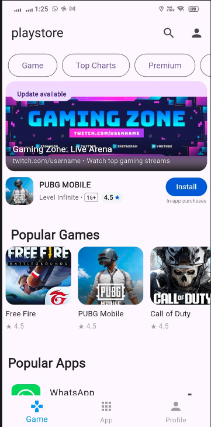
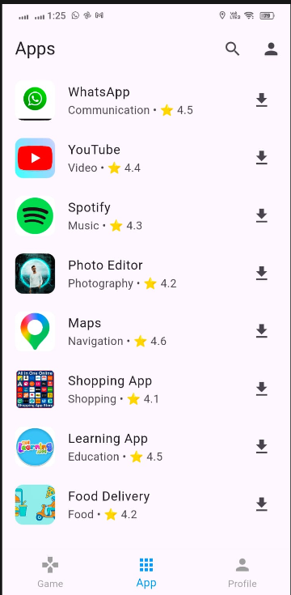

# Google Play Store UI Clone 📱

A production-grade Flutter clone of the official Google Play Store application. This project replicates Google Play Store's fluid UI architecture, signature scroll-driven auto-hiding navigation bars, interactive swipeable banners, and animated app installation flows.

---

## 📸 App Screenshots

<table align="center">
  <tr>
    <td align="center">
      <b>Figure 1: Home & Games Feed</b><br/><br/>
      <br/><br/>
      <sub>Floating AppBar, Category Filter Chips, Swipeable Hero Banners, and Popular Games Carousel</sub>
    </td>
    <td align="center">
      <b>Figure 2: Apps Directory Screen</b><br/><br/>
      <br/><br/>
      <sub>Categorized App listings with Star Ratings, Download Triggers, and Persistent Bottom Navigation</sub>
    </td>
  </tr>
</table>

---

## 🌟 Key Features & Code Architecture

### 1. 🔄 Google Play Store Scroll-Driven Auto-Hide (`NestedScrollView`)
- **How it works in code:**
  - Implemented using Flutter's `NestedScrollView` with `floatHeaderSlivers: true`.
  - The top app bar uses a `SliverAppBar` configured with:
    - `floating: true`: The header reappears as soon as the user reverses scroll direction upwards, without having to scroll all the way back to the top.
    - `snap: true`: Smoothly animates the header fully into or out of view on release.
    - `pinned: false`: Slides completely off-screen on downward scroll, giving games and apps 100% of the screen real estate.
  - The category pill buttons are hosted in `SliverAppBar.bottom` via `PreferredSize`, ensuring the search bar and category bar hide and reveal in unison.
  - The `BottomNavigationBar` remains anchored at the bottom of the `Scaffold` throughout the scroll.

### 2. 🎮 Interactive Swipeable Promotional Banners (`PageView` + `Stack`)
- **How it works in code:**
  - Built using a horizontal `PageView` displaying multi-layer composite cards.
  - **Visual Hierarchy (`Stack` + `Positioned`):**
    - **Base Layer:** High-resolution promo artwork (`Image.asset`).
    - **Top-Left Badge:** Rounded badge container with dynamic text (e.g., *"Update available"*, *"Special offer"*).
    - **Bottom Gradient Overlay:** A vertical `LinearGradient` from transparent to translucent black (`Colors.black.withValues(alpha: 0.85)`). This guarantees high contrast and readable text regardless of image brightness.
  - **Paired App Row:** Positioned right beneath the image is a dedicated action row with the app icon, title, age rating badge (`16+`), rating pill (`4.5 ★`), and a rounded Google-styled blue **Install** button.
  - Both banner and action row scroll horizontally together as a single swipeable unit.

### 3. 📥 Simulated Real-Time App Installation (`AppDetailPage`)
- **How it works in code:**
  - **Live Download Simulation:** Asynchronous timer-driven progress update simulating network download and installation states.
  - **Animated Feedback:** A `LinearProgressIndicator` displays real-time progress percentages with an active **Cancel** button.
  - **State Transitions:** Seamlessly switches between `Install`, `Downloading (0% - 100%)`, `Open`, and `Uninstall` states with reactive `SnackBar` confirmations.
  - **App Preview:** Includes screenshot preview carousels, expandable "About this app" information, developer credentials, and star breakdown distributions.

### 4. 🗂️ Dynamic Category & Top Charts Filter
- **Interactive Popup Menus:** Tapping **Top Charts** opens a floating dropdown menu (`showMenu`) allowing users to switch between:
  - *Top Free*
  - *Top Grossing*
  - *Top Paid*
- **Filtered Content:** Selecting any category (e.g., *Kids*, *Premium*, *Categories*) dynamically updates the list view with relevant games, descriptions, and app icons.

### 5. 📱 Bottom Navigation & Multi-Tab Support
- Persistent 3-tab navigation bar powered by `BottomNavigationBar`:
  - 🎮 **Game Tab:** Hero promo banners, Popular Games carousel, Popular Apps list, Recommended feed, and Offline Games.
  - 📱 **App Tab:** Curated apps catalog across Communication, Video, Music, Photography, Navigation, Shopping, and Food.
  - 👤 **Profile Tab:** User account info, downloads history, notification center, and settings.

---

## 📂 Project Structure

```text
playstore3/
├── assets/                  # All local game icons, banner art, and app images
│   ├── apps/               # Application icons
│   ├── banner1.png         # Promo banners
│   ├── categories/         # Category icons
│   └── games/              # Game artwork
├── lib/
│   └── main.dart           # Complete Flutter application code
├── screenshots/            # Showcase screenshots used in documentation
│   ├── home_screen.png     # Figure 1 screenshot
│   └── apps_screen.png     # Figure 2 screenshot
├── test/
│   └── widget_test.dart    # Automated widget tests for scroll & navigation
└── pubspec.yaml            # Project dependencies and asset registrations
```

---

## 🚀 Getting Started

### Prerequisites
- [Flutter SDK](https://docs.flutter.dev/get-started/install) (v3.0.0 or higher)
- [Dart SDK](https://dart.dev/get-dart)
- Android Studio / VS Code / Flutter CLI

### Installation & Run

1. **Clone the repository:**
   ```bash
   git clone https://github.com/irfanonline5811-afk/playstoredummy.git
   cd playstoredummy
   ```

2. **Fetch dependencies:**
   ```bash
   flutter pub get
   ```

3. **Run the project:**
   ```bash
   flutter run
   ```

4. **Run automated test suite:**
   ```bash
   flutter test
   ```

---

## 🛠️ Tech Stack & Dependencies

- **Language:** Dart 3.x
- **Framework:** Flutter 3.x
- **Architecture:** Widget-based reactive state management (`StatefulWidget`)
- **Key Widgets:** `NestedScrollView`, `SliverAppBar`, `PageView`, `ListView`, `Stack`, `Positioned`, `ClipRRect`, `LinearProgressIndicator`

---

## 📄 License

This project is created for educational and portfolio demonstration purposes.
